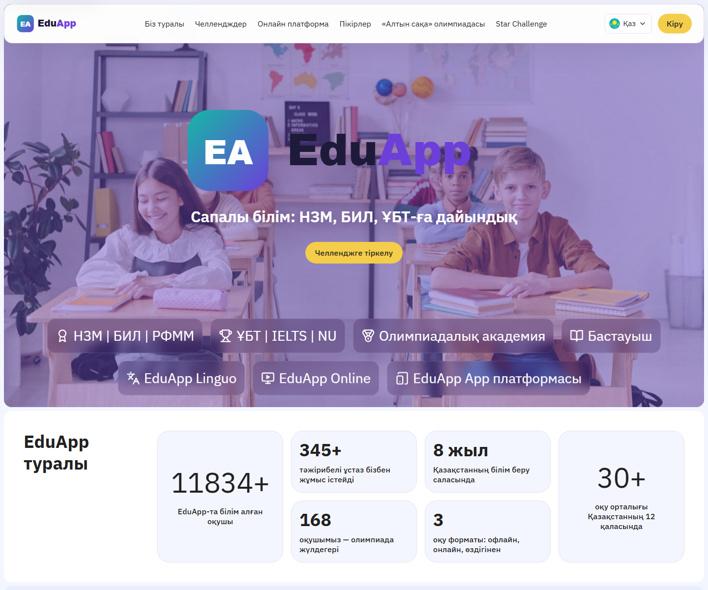

# EduApp — SEO-optimized single-file home page + copy deck

An SEO rewrite of an EdTech school's home page: a single self-contained HTML file (inline CSS + JS, no build step) with Kazakh/Russian switching, structured data and performance-minded animations — plus the copy deck (old text → new text) for porting the same content into the production Vue front end.



## Features

- **Single-file page** (`site/index.html`) — critical CSS inline, SVG sprite for icons, ~1 KB of JS per feature; opens straight from disk.
- **SEO** — keyword-driven title/description/H1–H3, canonical + hreflang (kk-KZ / ru-KZ / x-default), Open Graph, JSON-LD `@graph` (`EducationalOrganization`, `WebSite`), image preload with `fetchpriority`.
- **KZ ⇄ RU switch without reload** — Kazakh is server-rendered in the HTML; Russian strings live in an inline dictionary and are applied via `data-i18n`, `data-i18n-html`, `data-i18n-aria`, `data-i18n-alt`; language is remembered in `localStorage`.
- Animated counters (IntersectionObserver), reveal-on-scroll, accessible reviews carousel with dots, sticky header with mobile drawer, `prefers-reduced-motion` support.
- **Copy deck** (`content/front-landing.kk.json`, `front-landing.ru.json`) — a key → new-text map so the developers of the main SPA can replace the old strings 1:1.

## Tech stack

HTML5 · CSS (custom properties, grid, clamp) · vanilla JavaScript · JSON-LD / schema.org.

## Project structure

```
site/index.html                 the whole page (markup + inline CSS + inline JS + RU dictionary)
site/assets/                    placeholder logo/favicon/avatars, stock illustrations, icons
content/front-landing.kk.json   copy deck for the SPA (Kazakh)
content/front-landing.ru.json   copy deck for the SPA (Russian)
docs/screenshot.png
```

## How to run (demo mode)

Nothing to install:

```bash
# open directly
start site/index.html          # Windows  (or just double-click it)
# or serve it
python -m http.server 8000 --directory site   # → http://localhost:8000
```

> All data in this repository is randomly generated; brand names are anonymized. "EduApp", its logo, people, reviews, statistics, addresses and contacts are fictional. Exam/olympiad names (НЗМ, БИЛ, РФММ, ҰБТ, «Алтын сақа») are public. Classroom photos are free stock images.

## Кратко (RU)

SEO-переработка главной страницы образовательной школы: один HTML-файл (CSS и JS внутри), сборка не нужна.
Переключение казахский / русский без перезагрузки, есть структурированные данные JSON-LD.
В `content/` — карта текстов (старый текст → новый) для основного Vue-сайта.
Запуск: откройте `site/index.html` в браузере. Все данные вымышлены, названия брендов изменены.
